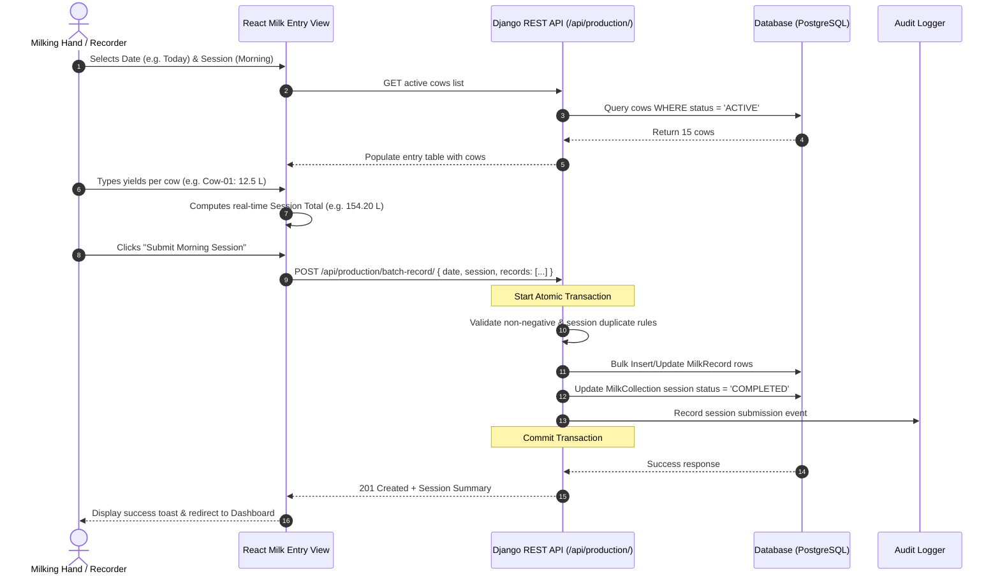
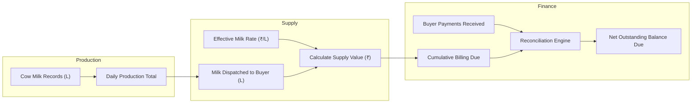

# Technical Architecture & Data Flow
## DAIRYTRACK: Dairy Farm Production & Management System

---

## 1. High-Level Architectural Pattern

DairyTrack follows a clean decoupled multi-tier architecture:

```
[ Client Presentation Tier ]       --> React 19 + TypeScript + Vite + Tailwind CSS
          | (HTTPS / REST JSON)
[ Application & API Tier ]          --> Python 3.12 + Django 5.x + Django REST Framework
          | (ORM / SQL Transactions)
[ Persistent Storage Tier ]         --> PostgreSQL 16+ / SQLite3 (Development)
          |
[ Audit & Security Engine ]         --> Immutable Mutation Logging & Row-Level Authorization
```

---

## 2. Layer Responsibilities

### 2.1 Presentation Layer (`frontend/`)
- **Technology:** React 19, TypeScript, Vite, Tailwind CSS, Lucide React, Recharts.
- **Design System:** Aero-Ground optical glassmorphism with dynamic dual-theme canvas (`Light: Sky Daylight`, `Dark: Deep Obsidian`).
- **State Management:**
  - `ThemeContext`: Controls system/manual theme toggle and persists preference.
  - `AuthContext`: Manages authenticated user session and role-gated UI capabilities.
  - Page-level reactive state with immediate client-side total calculations for milking inputs.
- **Responsiveness:** Fluid grid and drawer patterns optimized for mobile devices (barn hands) and desktop browsers (owner/accountant).

### 2.2 Application Layer (`backend/apps/`)
- **Technology:** Django 5.x, Django REST Framework (DRF), `django-cors-headers`.
- **Modular Apps:**
  - `accounts`: User authentication, role enforcement (`ADMIN`, `RECORDER`, `VIEWER`).
  - `cows`: Cow entity lifecycle, status transitions (`ACTIVE`, `DRY`, `SICK`, `INACTIVE`).
  - `production`: Milking collection sessions, individual cow yield records, transactional bulk entry, and aggregation queries.
  - `supply`: Wholesale buyer profiles, date-effective milk pricing, daily dispatch records.
  - `finance`: Buyer payment logs, balance reconciliation, farm operating expenses.
  - `audit`: Centralized model change tracking via signals or explicit audit services.

### 2.3 Persistence Layer (`PostgreSQL / SQLite`)
- Strict constraints:
  - `UNIQUE (cow_id, production_date, session)`
  - `UNIQUE (collection_date, session)`
  - `CHECK (quantity_litres >= 0)`
  - `CHECK (amount >= 0)`
- All quantities stored as `NUMERIC(6, 2)` (up to 9999.99 litres per cow per session).
- All currency stored as `NUMERIC(10, 2)` (exact currency math).

---

## 3. Data Flow Diagrams

### 3.1 Daily Milking Session Capture Workflow



### 3.2 Supply & Payment Reconciliation Workflow



---

## 4. Security & Role-Based Access Control (RBAC)

| Endpoint Group | Method | Admin | Recorder | Viewer |
| :--- | :---: | :---: | :---: | :---: |
| `/api/cows/` | `GET` | ✅ | ✅ | ✅ |
| `/api/cows/` | `POST`, `PUT`, `DELETE` | ✅ | ❌ | ❌ |
| `/api/cows/{id}/status/` | `PATCH` | ✅ | ✅ | ❌ |
| `/api/production/` | `GET` | ✅ | ✅ | ✅ |
| `/api/production/batch-record/` | `POST` | ✅ | ✅ | ❌ |
| `/api/production/{id}/` | `PATCH` (Corrections) | ✅ | $\le$ 24h only | ❌ |
| `/api/supply/` | `GET` | ✅ | ✅ | ✅ |
| `/api/supply/` | `POST` | ✅ | ✅ | ❌ |
| `/api/finance/payments/` | `GET`, `POST` | ✅ | ❌ | `GET` only |
| `/api/audit/` | `GET` | ✅ | ❌ | ❌ |

---

## 5. Deployment Topology

```
[ Internet Traffic ]
        |
    [ Nginx Reverse Proxy (SSL / Port 443) ]
        |
        +---- / -----------> [ Static React SPA Build Files ]
        |
        +---- /api/ --------> [ Gunicorn WSGI Server (Django REST API) ]
                                      |
                                [ PostgreSQL 16 DB ]
```
