# Entity Relationship Diagram (ERD)
## DAIRYTRACK: Dairy Farm Production & Management System

```mermaid
erDiagram
    USER ||--o{ MILK_RECORD : "records"
    USER ||--o{ AUDIT_LOG : "triggers"
    USER ||--o{ FARM_EXPENSE : "enters"

    COW ||--o{ MILK_RECORD : "produces"
    
    MILK_COLLECTION ||--o{ MILK_RECORD : "contains"

    BUYER ||--o{ SUPPLY_RECORD : "receives"
    BUYER ||--o{ PAYMENT : "makes"

    MILK_RATE ||--o{ SUPPLY_RECORD : "determines_pricing"

    USER {
        bigint id PK
        string username UK
        string email
        string first_name
        string last_name
        string role "ADMIN | RECORDER | VIEWER"
        boolean is_active
        timestamp date_joined
    }

    COW {
        bigint id PK
        string cow_code UK "Tag ID e.g. COW-001"
        string display_name "e.g. Lakshmi"
        string breed "e.g. Holstein Friesian, Jersey"
        date joined_on
        string status "ACTIVE | DRY | SICK | INACTIVE"
        text notes
        timestamp created_at
        timestamp updated_at
    }

    MILK_COLLECTION {
        bigint id PK
        date collection_date
        string session "MORNING | EVENING"
        timestamp recorded_at
        string status "OPEN | COMPLETED | LOCKED"
        text notes
    }

    MILK_RECORD {
        bigint id PK
        bigint cow_id FK
        bigint collection_id FK
        date production_date
        string session "MORNING | EVENING"
        decimal quantity_litres "NUMERIC(6,2)"
        bigint entered_by_id FK
        timestamp created_at
        timestamp updated_at
    }

    BUYER {
        bigint id PK
        string name UK "e.g. Apex Dairy Cooperative"
        string contact_person
        string phone
        string email
        text address
        boolean is_active
        timestamp created_at
    }

    MILK_RATE {
        bigint id PK
        decimal rate_per_litre "NUMERIC(7,2)"
        date effective_from
        date effective_to "Nullable"
        text notes
        timestamp created_at
    }

    SUPPLY_RECORD {
        bigint id PK
        bigint buyer_id FK
        bigint rate_id FK
        date supply_date
        string session "MORNING | EVENING | FULL_DAY"
        decimal quantity_litres "NUMERIC(6,2)"
        decimal rate_per_litre_applied "NUMERIC(7,2)"
        decimal total_amount "NUMERIC(10,2)"
        text notes
        timestamp created_at
    }

    PAYMENT {
        bigint id PK
        bigint buyer_id FK
        date payment_date
        decimal amount "NUMERIC(10,2)"
        string method "CASH | UPI | BANK_TRANSFER | CHEQUE"
        string reference_no
        text notes
        timestamp created_at
    }

    FARM_EXPENSE {
        bigint id PK
        date expense_date
        string category "FEED | VETERINARY | MEDICINE | EQUIPMENT | LABOR | OTHER"
        decimal amount "NUMERIC(10,2)"
        string description
        bigint entered_by_id FK
        timestamp created_at
    }

    AUDIT_LOG {
        bigint id PK
        bigint user_id FK
        string entity_name "e.g. Cow, MilkRecord"
        string record_id
        string action "CREATE | UPDATE | DELETE | STATUS_CHANGE"
        json change_summary
        string ip_address
        timestamp timestamp
    }
```

### Key Relational Constraints & Integrity
1. `MILK_RECORD`: `UNIQUE (cow_id, production_date, session)`
2. `MILK_COLLECTION`: `UNIQUE (collection_date, session)`
3. `COW`: `UNIQUE (cow_code)`
4. `BUYER`: `UNIQUE (name)`
5. `CHECK` constraints on all Decimal fields: `quantity_litres >= 0.00`, `amount >= 0.00`, `rate_per_litre > 0.00`.
